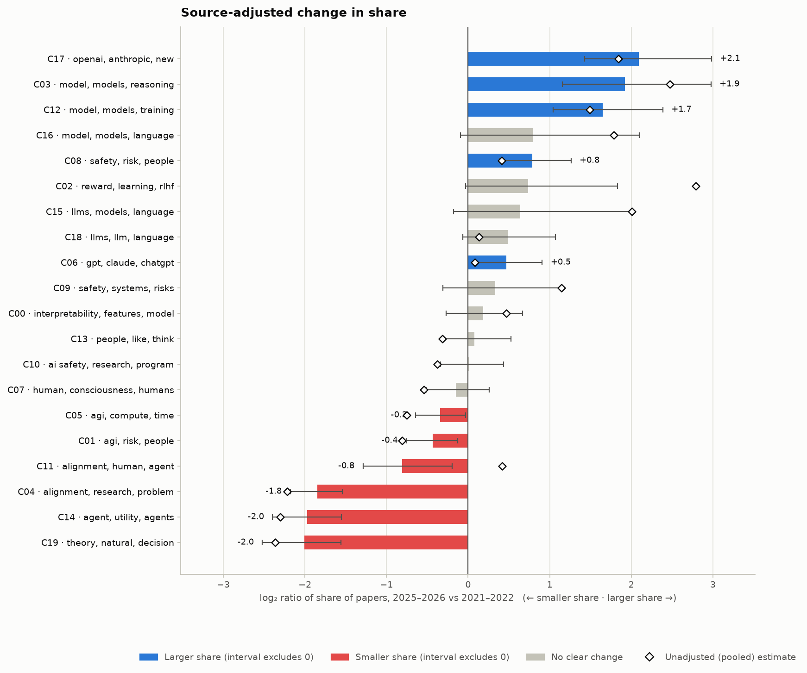
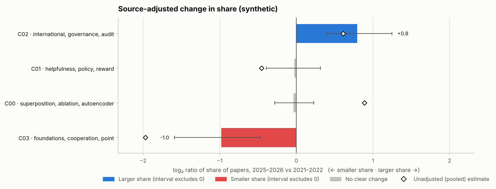

# alignmap

**How have the subfields of AI-alignment research shifted, and how sure can we be?**
`alignmap` maps the alignment literature across venues (Alignment Forum, LessWrong, EA Forum, arXiv, blogs) and tests, with uncertainty, which subfields gained or lost share between two periods, without letting a change in *where* people publish pass as a change in *what* they study.

<p align="center">
  <br>
  <sub>Change in each subfield's share of 18,809 Alignment Forum, LessWrong and arXiv documents, 2025–2026 vs 2021–2022 (data retrieved 30 October 2026; 2026 covers January–October).
  Bars are source-adjusted, with Bonferroni-corrected bootstrap intervals; colour means the interval excludes zero. Diamonds are the unadjusted pooled estimate. Full report: <a href="results/main-k20/report.md"><code>results/main-k20/report.md</code></a>.</sub>
</p>

## Status

v0.2. Pipeline, 150+ offline tests, a ground-truth check on synthetic data, and a **first run on the real literature** (below, October 2026).
The results are one run of one configuration with one seed, plus a robustness run with a second clustering method. Read them as a first map, with the caveats listed under *Results*, not as settled facts about the field.

## Results (October 2026)

**Corpus.** 18,809 documents from January 2021 to October 2026, after de-duplication of cross-posts: 11,960 LessWrong posts that are about AI (by tag or title), 3,062 Alignment Forum posts, and 3,787 arXiv abstracts found with a fixed list of alignment search terms. The EA Forum is not included: at the time of retrieval its API answered automated requests with a bot challenge. The baseline period is 2021–2022 (2,872 documents), the recent period 2025–2026 (9,782).

**Main run.** BGE-small embeddings → UMAP (10 d) → k-means with k = 20, every document assigned to a cluster. This configuration agrees best with the forum authors' own topic tags in the like-for-like comparison below. A second run with HDBSCAN instead of k-means ([`results/main-hdbscan`](results/main-hdbscan/report.md)) serves as a robustness check; the findings listed here hold in both runs.

What changed, within venues (source-adjusted; shares are of all documents in a period):

- **Agent foundations and decision theory shrank the most.** The cluster on agents, utility functions and goal-directedness fell from 7.5% to 1.9%, and the one on decision theory, natural abstractions, infra-Bayesianism and ELK from 6.0% to 1.5%. Both now hold about a quarter of their earlier share (log₂ ≈ −2; the HDBSCAN run gives 4.4% → 0.9%).
- **General discussion of "the alignment problem" and of research strategy shrank** from 12.8% to 3.6% (HDBSCAN: 8.5% → 2.2%).
- **Empirical safety work on current models grew.** A cluster on the safety of language and reasoning models (evaluations, emergent misalignment, chain of thought) went from 2.5% to 9.3%, and one on scheming, alignment faking and AI control from 2.1% to 6.5%. The HDBSCAN run isolates chain-of-thought monitoring on its own: 0.2% → 1.9%, the largest relative rise in either run.
- **Writing about the labs themselves** (OpenAI, Anthropic) grew from 0.9% to 4.0%, and safety policy, governance and advocacy from 3.0% to 5.2%.
- **Interpretability kept a roughly constant share** (7.6% → 8.6%, interval includes zero; HDBSCAN 8.2% → 8.6%). Its absolute volume grew with the field, but not faster than the field.
- **RLHF and preference learning look like a composition effect.** Pooled over venues the cluster seems to grow strongly (log₂ +2.8); within venues the change is small and not significant (+0.7, interval [−0.03, +1.83]). Most of the apparent growth comes from arXiv, where RLHF papers are common, taking a larger share of the corpus over time. This is the kind of artefact the source adjustment exists to catch.

**Method comparison.** All three embedders with the same clustering (k-means, k = 20) and the same 18,809 documents, scored on the 6,482 tagged forum posts ([`results/compare-k20`](results/compare-k20/compare.md); configuration in [`configs/fair-k20.json`](configs/fair-k20.json)):

| Embedding (→ UMAP → k-means, k = 20) | Tag agreement (AMI) | V-measure | Stability (ARI) |
|---|---:|---:|---:|
| TF-IDF + LSA, no neural model, no UMAP | 0.257 | 0.268 | 0.61 |
| SPECTER, the embedder of the 2022 analysis | 0.235 | 0.245 | 0.64 |
| BGE-small, general-purpose | **0.298** | **0.309** | 0.62 |

On this forum-heavy corpus the general-purpose embedder matches the authors' own topic tags best. SPECTER, which was trained on citation links between scientific papers, does slightly worse than plain bag-of-words here. The differences are moderate and come from one seed; they have not yet been checked across seeds.

The comparison at each preset's own settings ([`results/compare-presets`](results/compare-presets/compare.md)) shows why the like-for-like version is needed: the 2022-style arm with k = 5 scores 0.169, partly because five clusters cannot match thirty tags, and HDBSCAN scores 0.410 but leaves 59% of documents unassigned and is scored only on the 39% of tagged posts it does cluster.

**Caveats specific to this run.**
- arXiv coverage before 2023 is thin (93 abstracts in 2021–2022), because keyword search finds few papers before the field's vocabulary settled. The intervals for the papers group are wide as a result.
- The LessWrong set is the AI-related part of LessWrong as decided by tags and titles, which is a choice; 2026 covers ten months.
- Cluster names are the top c-TF-IDF keywords; the descriptions above are mine, written from those keywords and the representative titles listed in the reports.
- A few reference tags are not topics (`MATS Program`, `Fiction`, `OpenAI`); they lower every arm's agreement score by a similar amount but are worth removing in the next version.

To reproduce:

```bash
alignmap fetch --years 2021-2026 --out data/arxiv
alignmap fetch-forum --years 2021-2026 --out data/forums
alignmap run --input data/arxiv data/forums --out results/main-k20 --preset modern-fast --clusterer kmeans --k 20 \
    --drop-tags Newsletters --cache-dir .cache
alignmap compare --input data/arxiv data/forums --out results/compare-k20 --configs configs/fair-k20.json \
    --drop-tags Newsletters --cache-dir .cache
```

The forums and arXiv keep changing, so a fresh fetch will not give identical numbers; `run.json` records the SHA-256 of every input file used here. On a 4-vCPU machine without a GPU, embedding the corpus took about an hour with BGE-small and about four hours with SPECTER; everything else takes minutes once embeddings are cached.

## Why

The closest prior work is [Kirchner et al. (2022), *Researching Alignment Research: Unsupervised Analysis*](https://arxiv.org/abs/2206.02841). It showed that an unsupervised pipeline (SPECTER embeddings of title and abstract, UMAP, k-means) recovers meaningful subfields of alignment research, released a dataset, and gave a first picture of how the field's composition looked in 2022. This project takes that paper as its starting point and works on the questions its authors point to themselves: staleness, dependence on a few sources, and the subjectivity of some choices.

| In the 2022 analysis (as described in the paper) | Here |
|---|---|
| The clustered set was Alignment Forum posts plus arXiv papers (cluster sizes sum to about 3,200); the much larger LessWrong set served as a baseline and was not clustered. The authors note the resulting two-source bias. | Any mix of Alignment Forum, LessWrong, EA Forum, arXiv, Distill and blogs, from the [AI Alignment Research Dataset](https://github.com/StampyAI/alignment-research-dataset) or your own JSONL. Papers cross-posted between venues are de-duplicated, and a coverage table and staleness warnings show what each source contributes in each year. |
| Number of clusters fixed at k = 5, chosen from a residual plot; the authors describe part of the choice as subjective. | k by silhouette, or a density-based clusterer (HDBSCAN) that finds the number of subfields itself and leaves unclear papers explicitly *unassigned* instead of forcing them into a cluster. Each run reports stability across random 80% subsamples (adjusted Rand index). |
| Cluster names written by hand from word clouds. | Deterministic c-TF-IDF keywords and representative papers for every cluster; optional LLM names that are never treated as ground truth. Clusters are checked against an outside yardstick: the topic tags that forum authors attached to their own posts. |
| Change over time shown as shares per year, descriptively. | A log₂ ratio of each cluster's share (recent vs baseline) with a multinomial-bootstrap interval, Bonferroni-adjusted across clusters, and a flag only when the interval excludes zero. |
| A pooled corpus: a shift in the mix of venues over the years can move cluster shares. | A **source-adjusted** estimate: shares are computed within each venue group and recombined with fixed weights, so only within-venue change counts. The pooled estimate is shown next to it; a large gap is a composition effect. |
| Analysis code available on request; the corpus ages. | Open code, seeds, input checksums and library versions in `run.json`, a download manifest with SHA-256 per file, and a pipeline that can be re-run when the data are refreshed. |

None of this diminishes what the 2022 work did with the tools and data of its time; it is the follow-up that paper invites.

## What is compared

`alignmap compare` runs several pipelines on the **same** posts and scores each against the community's own tags (adjusted mutual information; the methods never see the tags), alongside stability, share of papers left unassigned, and wall-clock time.

| Preset | Embedding | Reduction | Clustering | Role |
|---|---|---|---|---|
| `lsa-baseline` | TF-IDF + LSA (no neural model) | none | k-means, k = 20 | floor: how far do bag-of-words vectors get? |
| `2022-style` | [SPECTER](https://arxiv.org/abs/2004.07180) (`allenai-specter`), `title[SEP]abstract` | UMAP, n_neighbors = 250 | k-means, k = 5 | approximate reconstruction of the 2022 pipeline (UMAP dimension is not stated in the paper, so 5 is assumed; not an exact replication) |
| `modern-fast` | BGE-small (`BAAI/bge-small-en-v1.5`), 512 tokens | UMAP, 10 d | HDBSCAN | small general-purpose embedder that runs on a laptop CPU |
| `modern-strong` | BGE-M3 (`BAAI/bge-m3`), 1,024 tokens | UMAP, 10 d | HDBSCAN | longer inputs, larger model |

SPECTER vectors are 768-number summaries of a paper, produced by a model trained so that papers that cite each other end up close together. General-purpose embedders such as BGE are trained on far more varied text and accept longer inputs, which matters for forum posts that have no abstract; whether that translates into better topic structure here is exactly what the comparison measures.
Embeddings are cached on disk by content hash, so comparing many clustering choices embeds the corpus once.

## Quick start

```bash
git clone https://github.com/sedcore/alignmap && cd alignmap
python -m venv .venv && source .venv/bin/activate      # Windows: .venv\Scripts\activate
pip install -e ".[dev]"                                 # add ,sbert for neural embedders; ,llm for cluster names

pytest                                                  # offline
alignmap demo                                           # synthetic corpus, offline, a few seconds

# data. The public dataset ends in late 2023, so for 2024-2026 fetch from the sources themselves:
alignmap fetch --years 2021-2026 --out data/arxiv           # arXiv abstracts (about 3 s between requests)
alignmap fetch-forum --years 2021-2026 --out data/forums    # LessWrong, Alignment Forum, EA Forum (plain text, AI-related posts)
alignmap download --out data/ard                            # optional: the AI Alignment Research Dataset (large, to late 2023)

# the question: which subfields changed share, adjusted for venue mix?
alignmap run --input data/arxiv data/forums --out results/main --preset modern-fast --cache-dir .cache \
    --drop-tags Newsletters

# the method comparison, scored against community tags
pip install -e ".[modern]"
alignmap compare --input data/arxiv data/forums --out results/compare --cache-dir .cache \
    --presets lsa-baseline 2022-style modern-fast --drop-tags Newsletters
```

Open `results/main/report.md` and `results/compare/compare.md`. Flags given on the command line override a preset, which overrides the defaults.

| Flag | Effect |
|---|---|
| `--sources alignmentforum lesswrong arxiv` | keep only these sources |
| `--drop-tags Newsletters` | leave out posts carrying these community tags (digests mix every topic and form a cluster of their own) |
| `--k auto --k-range 8 30 2` | choose k by silhouette (k-means) |
| `--min-cluster-size 0.01` | HDBSCAN minimum cluster size; below 1 it is a fraction of the papers |
| `--baseline 2021-2022 --recent 2025-2026` | the two periods to compare |
| `--min-group-docs 30` | smallest venue group, per period, used in the adjustment |
| `--llm-labels` | name clusters with Claude (`ANTHROPIC_API_KEY`; model via `--llm-model` or `ALIGNMAP_LLM_MODEL`) |
| `--tag-top 30 --tag-exclude AI Rationality` | which community tags serve as reference labels |

## Data

`alignmap download` fetches the per-source JSONL files of the AI Alignment Research Dataset (MIT-licensed, hosted on Hugging Face) and writes `ard_manifest.json` with URL, size, SHA-256 and repository commit for each file. Records use one schema (`id, source, title, authors, text, url, date_published`, plus abstract, categories or forum tags where the source has them), and `alignmap fetch` writes arXiv abstracts in the same schema, so sources mix freely.
The dataset's update schedule is not guaranteed, so every run prints a coverage table (papers per source per year) and warns when a source stops well before the newest one, because a stale source makes its topics look like they declined.
**Recent data.** The public dataset was last updated in November 2023, so it cannot say anything about 2024-2026. `alignmap fetch-forum` therefore reads the three forums' public GraphQL API (they run the same software) and writes the same schema, with the post text as plain text (no HTML or MathJax). Posts are walked newest first with a short pause between requests. The query repairs itself when a site lacks a field, and a small probe checks that the server honours the paging argument before relying on it; what was used and dropped is written to `manifest_forums.json`. On LessWrong and the EA Forum a post is kept only if its tags or title mention AI (see `AI_PATTERN` in `forum.py`; `--all-posts` switches the filter off); on the Alignment Forum every post is kept. That filter is an assumption that shapes the corpus, and very recent posts may not have been tagged yet, which the title test only partly makes up for.

**Cleaning.** Raw posts carry markup that is not content (image and link URLs, MathJax stylesheets, LaTeX, the plain-text residue of LaTeXML conversion, reference markers). Left in, it dominates TF-IDF and clusters form around formatting; the first real-data smoke run showed exactly this. `clean_text` removes these before anything is embedded. It is a set of heuristics, tested on hand-made examples and on pathological inputs (it must stay linear on very long tokens), not a guarantee: inspect the representative titles and keywords in the report.

Reports and CSVs contain titles, links and cluster labels only, not the full texts. Respect the licences of the underlying sources when you share data.

## How it works

```
JSONL sources ─► clean, de-duplicate ─► embed ─► (UMAP) ─► cluster ─► label ─► shift tables ─► report
(AF, LW, EA,     date, length, id/title  TF-IDF   optional  k-means    c-TF-IDF  pooled and     markdown, figures,
 arXiv, blogs)   most specific source    or SBERT           or HDBSCAN keywords  source-        CSV, run.json
                 wins on duplicates                                      [+ LLM]  adjusted
```

1. **One clustering for all years.** "Cluster 7 in 2022" and "cluster 7 in 2026" are the same thing. Clustering periods separately would make a shift unmeasurable.
2. **Shares, not counts.** Volume grew by an order of magnitude; raw counts would make every cluster look like it is growing.
3. **Uncertainty on every shift.** Additive smoothing, multinomial bootstrap, Bonferroni-adjusted intervals. A cluster is flagged only if its interval excludes zero.
4. **Adjust for venue mix.** Within each venue group (forum, papers, blogs), shares are combined with weights that are the same in both periods. Groups with too few papers in either period are left out and named in the report.
5. **Noise is a result, not an error.** With HDBSCAN, papers that belong to no dense region are reported as unassigned; agreement scores are computed on clustered papers and shown together with the share left out.
6. **Stability is reported, not assumed.** Mean adjusted Rand index between fits on random 80% subsamples, noise excluded; plus silhouette.
7. **Weak supervision from the community.** Tags such as "Interpretability" or "AI Governance" are human topic judgements that no pipeline here sees. They are multi-label, unevenly applied and coarse, so scores compare methods on identical data and make no absolute claim.
8. **The LLM is never the ground truth.** Keywords are deterministic. If enabled, Claude only turns keywords and representative titles into a name and a one-line summary; an API error falls back to the keyword label.
9. **Reproducible by construction.** Seeds, input hashes, library versions and the full configuration are written to `run.json`.

## Tests

`pytest` runs offline. The key checks use **synthetic corpora with known structure** (`alignmap.toy`), always bannered as synthetic in reports:

<p align="center">
  <br>
  <sub>Output of <code>alignmap demo</code> on a <b>synthetic</b> corpus built so that the venue mix drifts (20% → 70% papers) while topics inside each venue barely change.
  The pooled estimate (diamonds) reports a spurious rise of the interpretability-like cluster; the source-adjusted estimate (bars) does not, and flags only the two clusters that really moved.</sub>
</p>


- *Planted trend*: interpretability 10% → 40%, agent foundations 35% → 5%, RLHF and governance flat. The pipeline must recover the right clusters, signs and magnitudes and must not flag the flat ones.
- *Composition drift*: two venues with different topic mixes and a venue mix that drifts. Inside each venue only two topics really change. The pooled analysis must be fooled (a spurious rise), the source-adjusted one must not, and it must still detect the two real changes.

Other tests cover corpus cleaning and de-duplication, HDBSCAN and UMAP behaviour, agreement scores against tags, the embedding cache, a simulated dataset download (checksums, no partial files left after a truncated transfer), the arXiv Atom parser and the forum GraphQL fetcher against fake servers (schema differences, paging strategies, retries), the text-cleaning heuristics, and the LLM path with a fake client.

## Limitations

- **Synthetic validation is not real-data validation.** Passing the planted-structure tests shows the statistics are right, not that real subfields are as separable as the toy ones.
- **Tags are a noisy yardstick** and exist only for forum posts; arXiv papers carry no tags here, so agreement is measured on tagged posts and says little about papers.
- **Venue adjustment is coarse.** It removes changes in the mix of three venue groups, not other confounders (for example, who writes where, or topic-dependent migration between venues).
- **Embedding choices matter and are untuned.** The HDBSCAN default (1% of papers) and the UMAP settings are starting points; rerun with other settings before reading a story into one cluster. Intervals reflect sampling of papers only, not the choice of method.
- **The `2022-style` arm is a reconstruction**, with the UMAP dimension assumed.
- **Corpus boundaries.** Coverage and update dates differ by source; work outside these venues is not seen. The forum AI filter (tags or title) and the arXiv search terms decide what counts as "alignment", and the same arXiv term list is used for every year on purpose, so a subfield cannot look new just because of how the corpus was queried.
- **Live fetching depends on the sites.** The fetchers are tested against fake servers and were used for the October 2026 crawl of LessWrong and the Alignment Forum (the servers cap paging offsets, which the fetcher works around with date windows); the EA Forum refused automated requests at that time. Check `manifest_forums.json` and the coverage table of each run.
- **LLM names are unverified paraphrases** and have not been validated against human labels.

## Roadmap

- Repeat the run and the comparison over several seeds and report the spread; drop non-topic tags from the reference set.
- Add the EA Forum (if its API becomes reachable) and a broader arXiv sample (category- or citation-based rather than keyword-based).
- Soft cluster membership and hierarchical views, instead of one label per paper.
- A relevance classifier to find alignment work outside the keyword net.
- Author and venue communities per subfield; validate LLM names against human labels.

## References

- J. H. Kirchner, L. Smith, J. Thibodeau, K. McDonell, L. Reynolds (2022). *Researching Alignment Research: Unsupervised Analysis.* [arXiv:2206.02841](https://arxiv.org/abs/2206.02841)
- StampyAI, [AI Alignment Research Dataset](https://github.com/StampyAI/alignment-research-dataset) (source of the JSONL schema and of `alignmap download`); the 2022 paper links its own dataset repository, [moirage/alignment-research-dataset](https://github.com/moirage/alignment-research-dataset)
- A. Cohan, S. Feldman, I. Beltagy, D. Downey, D. Weld (2020). *SPECTER: Document-level Representation Learning using Citation-informed Transformers.* [arXiv:2004.07180](https://arxiv.org/abs/2004.07180)
- L. McInnes, J. Healy, J. Melville (2018). *UMAP: Uniform Manifold Approximation and Projection for Dimension Reduction.* [arXiv:1802.03426](https://arxiv.org/abs/1802.03426)
- R. Campello, D. Moulavi, J. Sander (2013). *Density-Based Clustering Based on Hierarchical Density Estimates.* PAKDD.
- S. Xiao et al. (2023). *C-Pack: Packaged Resources To Advance General Chinese Embedding* (BGE). [arXiv:2309.07597](https://arxiv.org/abs/2309.07597); J. Chen et al. (2024). *BGE M3-Embedding.* [arXiv:2402.03216](https://arxiv.org/abs/2402.03216)
- M. Grootendorst (2022). *BERTopic: Neural topic modeling with a class-based TF-IDF procedure.* [arXiv:2203.05794](https://arxiv.org/abs/2203.05794)
- N. X. Vinh, J. Epps, J. Bailey (2010). *Information Theoretic Measures for Clusterings Comparison.* JMLR 11.

## License

MIT. If you use this code, see `CITATION.cff`.
