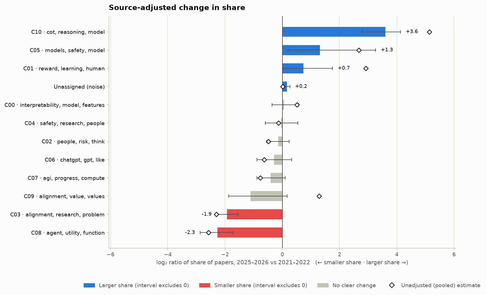
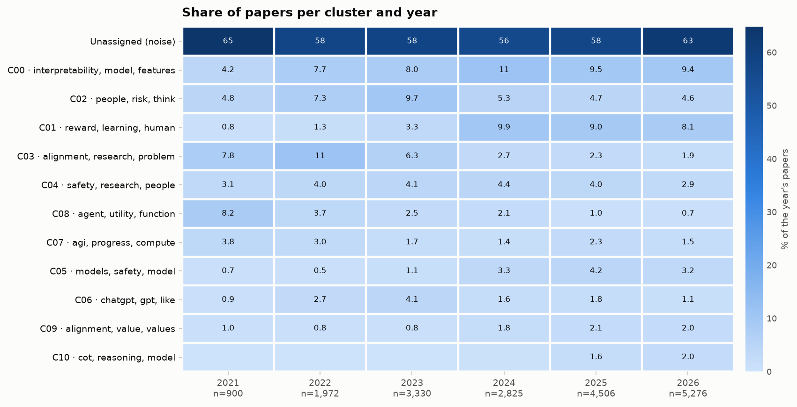

# Alignment-research map: 2025–2026 vs 2021–2022

**Corpus.** 18,809 papers kept of 22,698 read (0 from other sources, 0 without a usable date, 437 too short, 3160 duplicates, 292 excluded by tag). Sources: lesswrong (11,960), arxiv (3,787), alignmentforum (3,062).

**Structure.** UMAP(10d, n_neighbors=30) → HDBSCAN (min_cluster_size=1.0% of documents) → 11 clusters, 59.2% unassigned · silhouette 0.058 · stability (ARI across 80% subsamples) 0.993.

**Agreement with community tags.** AMI 0.410, V-measure 0.424 on 2,502 tagged posts (39% of tagged posts were clustered). Tags used: `Interpretability (ML & AI)`, `AI Risk`, `Language Models (LLMs)`, `AI Governance`, `AI Control`, `Machine Learning  (ML)`, `AI Timelines`, `MATS Program`, `AI Evaluations`, `AI Alignment Fieldbuilding`, `GPT`, `Existential risk`, `Outer Alignment`, `Inner Alignment`, `Deceptive Alignment`, `AI Takeoff`, `Agent Foundations`, `Fiction`, `OpenAI`, `Sparse Autoencoders (SAEs)`, `Ethics & Morality`, `Reinforcement learning`, `Forecasting & Prediction`, `Logic & Mathematics`, `Corrigibility`, `AI Capabilities`, `ChatGPT`, `Economics`, `Chain-of-Thought Alignment`, `Agency`.

## Sources and coverage

Papers kept per source and year:

| Source | 2021 | 2022 | 2023 | 2024 | 2025 | 2026 |
|---|---:|---:|---:|---:|---:|---:|
| alignmentforum | 516 | 687 | 720 | 412 | 526 | 201 |
| arxiv | 29 | 64 | 255 | 686 | 1,228 | 1,525 |
| lesswrong | 355 | 1,221 | 2,355 | 1,727 | 2,752 | 3,550 |

## Which subfields changed share?

The main result is **source-adjusted**: cluster shares are computed within each source group (forum, papers) and combined with fixed weights, so a change in the mix of venues cannot masquerade as a change in topics. Hollow diamonds in the figure show the unadjusted pooled estimate; a large gap between a diamond and its bar is a composition effect.

| Cluster | Share before → after | log₂ ratio [Bonferroni interval] | Verdict | Unadjusted log₂ |
|---|---|---|---|---:|
| C10 · cot, reasoning, model | 0.2% → 1.9% | +3.60 [+2.78, +4.13] | ▲ larger share | +5.14 |
| C05 · models, safety, model | 1.4% → 3.4% | +1.31 [+0.20, +3.26] | ▲ larger share | +2.67 |
| C01 · reward, learning, human | 4.2% → 7.0% | +0.73 [+0.02, +1.76] | ▲ larger share | +2.91 |
| Unassigned (noise) | 55.6% → 62.1% | +0.16 [+0.06, +0.26] | ▲ larger share | +0.01 |
| C00 · interpretability, model, features | 8.2% → 8.6% | +0.06 [-0.35, +0.57] | — | +0.51 |
| C04 · safety, research, people | 3.7% → 3.6% | -0.05 [-0.60, +0.54] | — | -0.13 |
| C02 · people, risk, think | 5.5% → 5.0% | -0.14 [-0.54, +0.24] | — | -0.49 |
| C06 · chatgpt, gpt, like | 1.9% → 1.5% | -0.29 [-0.88, +0.32] | — | -0.63 |
| C07 · agi, progress, compute | 2.7% → 2.1% | -0.40 [-0.89, +0.10] | — | -0.77 |
| C09 · alignment, value, values | 3.8% → 1.8% | -1.11 [-1.87, +0.17] | — | +1.29 |
| C03 · alignment, research, problem | 8.5% → 2.2% | -1.93 [-2.29, -1.55] | ▼ smaller share | -2.30 |
| C08 · agent, utility, function | 4.4% → 0.9% | -2.26 [-2.87, -1.73] | ▼ smaller share | -2.58 |

## Share of papers per cluster and year (pooled)

## Clusters

### C00 · interpretability, model, features

1,696 papers (9.0%) · keywords: interpretability, model, features, models, mechanistic, neural, feature, sparse

- [Interpretability as Compression: Reconsidering SAE Explanations of Neural Activations with MDL-SAEs](https://www.lesswrong.com/posts/G2oyFQFTE5eGEas6m/interpretability-as-compression-reconsidering-sae) (2024)
- [Representation as a Bottleneck for Mechanistic Interpretability: The Manifestation Unit Protocol](https://arxiv.org/abs/2607.00089) (2026)
- [Transcoders enable fine-grained interpretable circuit analysis for language models](https://www.alignmentforum.org/posts/YmkjnWtZGLbHRbzrP/transcoders-enable-fine-grained-interpretable-circuit) (2024)
- [Interpretability in Parameter Space: Minimizing Mechanistic Description Length with Attribution-based Parameter Decomposition](https://arxiv.org/abs/2501.14926) (2025)
- [Mechanistic Interpretability for Neural Networks: Circuits, Sparse Features and Symbolic Reasoning](https://arxiv.org/abs/2607.07316) (2026)

### C01 · reward, learning, human

1,254 papers (6.7%) · keywords: reward, learning, human, rlhf, preference, models, reinforcement, model

- [Reinforcement Learning from Human Feedback: A Statistical Perspective](https://arxiv.org/abs/2604.02507) (2026)
- [RLHF Deciphered: A Critical Analysis of Reinforcement Learning from Human Feedback for LLMs](https://arxiv.org/abs/2404.08555) (2024)
- [Solving the Inverse Alignment Problem for Efficient RLHF](https://arxiv.org/abs/2412.10529) (2024)
- [The Alignment Ceiling: Objective Mismatch in Reinforcement Learning from Human Feedback](https://arxiv.org/abs/2311.00168) (2023)
- [Secrets of RLHF in Large Language Models Part II: Reward Modeling](https://arxiv.org/abs/2401.06080) (2024)

### C02 · people, risk, think

1,114 papers (5.9%) · keywords: people, risk, think, like, world, agi, humans, humanity

- [Worlds where I wouldn't worry about AI risk](https://www.lesswrong.com/posts/PqXsj5MHWryBDwxMC/worlds-where-i-wouldn-t-worry-about-ai-risk) (2023)
- [Near-Term Risks of an Obedient Artificial Intelligence](https://www.lesswrong.com/posts/iM2ujcBohJvoJzjBa/near-term-risks-of-an-obedient-artificial-intelligence) (2023)
- [Reshaping the AI Industry](https://www.alignmentforum.org/posts/mF8dkhZF9hAuLHXaD/reshaping-the-ai-industry) (2022)
- [[LQ] Some Thoughts on Messaging Around AI Risk](https://www.lesswrong.com/posts/eJrMaGZGut4Qaefsj/lq-some-thoughts-on-messaging-around-ai-risk) (2022)
- [AI as a natural disaster](https://www.lesswrong.com/posts/hsLRGwLnmkpHhvMuf/ai-as-a-natural-disaster-Edta) (2024)

### C03 · alignment, research, problem

781 papers (4.2%) · keywords: alignment, research, problem, agi, think, like, people, post

- [A Case for the Least Forgiving Take On Alignment](https://www.alignmentforum.org/posts/3JRBqRtHBDyPE3sGa/a-case-for-the-least-forgiving-take-on-alignment) (2023)
- [Research request (alignment strategy): Deep dive on "making AI solve alignment for us"](https://www.alignmentforum.org/posts/amoS8fGYsRKo6Wsdd/research-request-alignment-strategy-deep-dive-on-making-ai) (2022)
- [Three Alignment Schemas & Their Problems](https://www.lesswrong.com/posts/YL2RpsCsFuDBgz4HS/three-alignment-schemas-and-their-problems) (2022)
- [Can someone explain to me why most researchers think alignment is probably something that is humanly tractable?](https://www.lesswrong.com/posts/zwZ7ZBXXFDXNeBsXo/can-someone-explain-to-me-why-most-researchers-think) (2022)
- [A Simple Alignment Typology](https://www.lesswrong.com/posts/T2FGbZw8TYsjcpQBn/a-simple-alignment-typology) (2023)

### C04 · safety, research, people

697 papers (3.7%) · keywords: safety, research, people, work, technical, projects, program, field

- [AI Safety Ideas: A collaborative AI safety research platform](https://www.lesswrong.com/posts/iAkJ3zzAqgZfwfg3e/ai-safety-ideas-a-collaborative-ai-safety-research-platform) (2022)
- [I made an AI safety fellowship. What I wish I knew.](https://www.lesswrong.com/posts/88cEgGcSXwFvPms4s/i-made-an-ai-safety-fellowship-what-i-wish-i-knew) (2024)
- [Thoughts on AI Safety Camp](https://www.lesswrong.com/posts/3kErRpEprB8iJvnNq/thoughts-on-ai-safety-camp) (2022)
- [Some (potentially) fundable AI Safety Ideas](https://www.lesswrong.com/posts/FrdZaTyfBgEvPFqN4/some-potentially-fundable-ai-safety-ideas) (2022)
- [An Outsider’s Roadmap into AI Safety Research (2025)](https://www.lesswrong.com/posts/bcuzjKmNZHWDuEwBz/an-outsider-s-roadmap-into-ai-safety-research-2025) (2025)

### C05 · models, safety, model

503 papers (2.7%) · keywords: models, safety, model, llms, adversarial, harmful, language, llm

- [Assessing Domain-Level Susceptibility to Emergent Misalignment from Narrow Finetuning](https://arxiv.org/abs/2602.00298) (2026)
- [Adversarial Pragmatics for AI Safety Evaluation: A Diagnostic Framework and Seed Benchmark for Language-Mediated Control](https://arxiv.org/abs/2607.01153) (2026)
- [EvalSafetyGap: A Hybrid Survey and Conceptual Framework for LLM Evaluation-Safety Failures](https://arxiv.org/abs/2606.30219) (2026)
- [The AI Safety Illusion: Why Current Safety Datasets Fool Us on Model Safety](https://www.lesswrong.com/posts/5mxco72CGDRsumZHW/the-ai-safety-illusion-why-current-safety-datasets-fool-us-1) (2026)
- [Dark LLMs: The Growing Threat of Unaligned AI Models](https://arxiv.org/abs/2505.10066) (2025)

### C06 · chatgpt, gpt, like

379 papers (2.0%) · keywords: chatgpt, gpt, like, prompt, writing, openai, just, ve

- [Shh, don't tell the AI it's likely to be evil](https://www.lesswrong.com/posts/RAA6oH34eTMYb5CGo/shh-don-t-tell-the-ai-it-s-likely-to-be-evil) (2022)
- [ChatGPT's Misalignment Isn't What You Think](https://www.lesswrong.com/posts/SnS8JhnqqGvMTxxuD/chatgpt-s-misalignment-isn-t-what-you-think) (2022)
- [So You Think You've Awoken ChatGPT](https://www.lesswrong.com/posts/2pkNCvBtK6G6FKoNn/so-you-think-you-ve-awoken-chatgpt) (2025)
- [Did ChatGPT just gaslight me?](https://www.lesswrong.com/posts/goC9qv4PWf2cjfnbm/did-chatgpt-just-gaslight-me) (2022)
- [ChatGPT: First Impressions](https://www.lesswrong.com/posts/jjb7mLwZt5cxChz2n/chatgpt-first-impressions) (2022)

### C07 · agi, progress, compute

374 papers (2.0%) · keywords: agi, progress, compute, timelines, time, years, intelligence, year

- [Takes and loose predictions on AI progress and some key problems](https://www.lesswrong.com/posts/KYghMi7cYCM5z76Lt/takes-and-loose-predictions-on-ai-progress-and-some-key) (2025)
- [What Indicators Should We Watch to Disambiguate AGI Timelines?](https://www.lesswrong.com/posts/auGYErf5QqiTihTsJ/what-indicators-should-we-watch-to-disambiguate-agi) (2025)
- [Research note: A simpler AI timelines model predicts 99% AI R&D automation in ~2032](https://www.alignmentforum.org/posts/uy6B5rEPvcwi55cBK/research-note-a-simpler-ai-timelines-model-predicts-99-ai-r) (2026)
- [Towards Better Milestones for Monitoring AI Capabilities](https://www.lesswrong.com/posts/CDJmafoeZJuXHbKDW/towards-better-milestones-for-monitoring-ai-capabilities) (2023)
- [BCIs and the ecosystem of modular minds](https://www.lesswrong.com/posts/d74pb97TAqNKwJkc5/bcis-and-the-ecosystem-of-modular-minds) (2023)

### C08 · agent, utility, function

369 papers (2.0%) · keywords: agent, utility, function, theorem, agents, post, world, probability

- [Elementary Infra-Bayesianism](https://www.alignmentforum.org/posts/9uj2Mto9CNdWZudyq/elementary-infra-bayesianism) (2022)
- [Selection Theorems: A Program For Understanding Agents](https://www.alignmentforum.org/posts/G2Lne2Fi7Qra5Lbuf/selection-theorems-a-program-for-understanding-agents) (2021)
- [Crystal Healing — or the Origins of Expected Utility Maximizers](https://www.lesswrong.com/posts/tiftX2exZbrc3pNJt/crystal-healing-or-the-origins-of-expected-utility) (2023)
- [Measuring Coherence and Goal-Directedness in RL Policies](https://www.lesswrong.com/posts/g5XgjY6x9dz47LgAz/measuring-coherence-and-goal-directedness-in-rl-policies) (2024)
- [Satisficers Tend To Seek Power: Instrumental Convergence Via Retargetability](https://www.alignmentforum.org/posts/nZY8Np759HYFawdjH/satisficers-tend-to-seek-power-instrumental-convergence-via) (2021)

### C09 · alignment, value, values

304 papers (1.6%) · keywords: alignment, value, values, human, systems, moral, llms, models

- [Toward a Theory of Value in AI Alignment](https://arxiv.org/abs/2608.10327) (2026)
- [ValueCompass: A Framework for Measuring Contextual Value Alignment Between Human and LLMs](https://arxiv.org/abs/2409.09586) (2024)
- [Normative Conflicts and Shallow AI Alignment](https://arxiv.org/abs/2506.04679) (2025)
- [Position: Towards Bidirectional Human-AI Alignment](https://arxiv.org/abs/2406.09264) (2024)
- [Wide Reflective Equilibrium in LLM Alignment: Bridging Moral Epistemology and AI Safety](https://arxiv.org/abs/2506.00415) (2025)

### C10 · cot, reasoning, model

196 papers (1.0%) · keywords: cot, reasoning, model, models, thought, chain, monitoring, monitor

- [Investigating encoded reasoning in LLMs](https://www.lesswrong.com/posts/Cgfj9AZqdcysqL7jN/investigating-encoded-reasoning-in-llms) (2026)
- [Exploring Reinforcement Learning Effects on Chain-of-Thought Legibility](https://www.lesswrong.com/posts/9z6TuKEgZNsmqdfy6/exploring-reinforcement-learning-effects-on-chain-of-thought) (2026)
- [Measuring Beliefs of Language Models During Chain-of-Thought Reasoning](https://www.alignmentforum.org/posts/a86uAnPykqNtmEbDH/measuring-beliefs-of-language-models-during-chain-of-thought-1) (2025)
- [Reasoning Models Don't Always Say What They Think](https://arxiv.org/abs/2505.05410) (2025)
- [Investigating CoT Monitorability in Large Reasoning Models](https://arxiv.org/abs/2511.08525) (2025)

## Settings

- embedder `BAAI/bge-small-en-v1.5`; clustering: UMAP(10d, n_neighbors=30) → HDBSCAN (min_cluster_size=1.0% of documents)
- baseline 2021–2022, recent 2025–2026; 5,000 bootstrap draws; seed 0
- LLM labels: no (keywords only)

## Read this before quoting a number

- The corpus is whatever the sources contain, not the whole field. Sources that stop being updated make their topics look like they declined (see the coverage warnings above).
- Shares are relative: when one cluster grows, the others must shrink. Intervals reflect sampling of papers only, not the choice of embedder, clustering or sources.
- Clusters are a convenient partition, not ground truth; rerun with another method before reading a story into one cluster.
- LLM names and summaries, when present, are unverified paraphrases of the keywords and titles.
