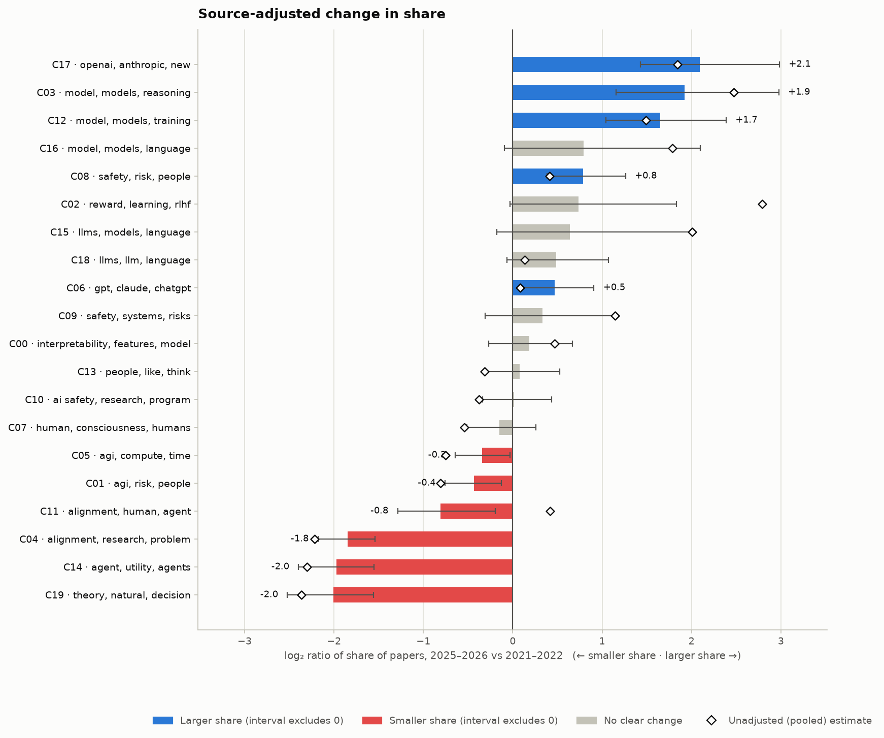
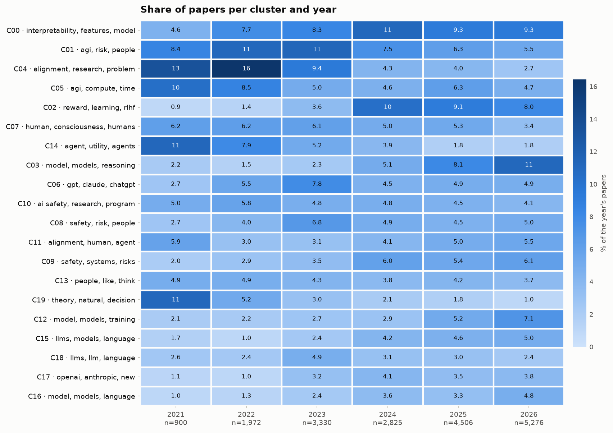

# Alignment-research map: 2025–2026 vs 2021–2022

**Corpus.** 18,809 papers kept of 22,698 read (0 from other sources, 0 without a usable date, 437 too short, 3160 duplicates, 292 excluded by tag). Sources: lesswrong (11,960), arxiv (3,787), alignmentforum (3,062).

**Structure.** UMAP(10d, n_neighbors=30) → k-means (k=20) → 20 clusters · silhouette 0.015 · stability (ARI across 80% subsamples) 0.622.

**Agreement with community tags.** AMI 0.298, V-measure 0.309 on 6,482 tagged posts (100% of tagged posts were clustered). Tags used: `Interpretability (ML & AI)`, `AI Risk`, `Language Models (LLMs)`, `AI Governance`, `AI Control`, `Machine Learning  (ML)`, `AI Timelines`, `MATS Program`, `AI Evaluations`, `AI Alignment Fieldbuilding`, `GPT`, `Existential risk`, `Outer Alignment`, `Inner Alignment`, `Deceptive Alignment`, `AI Takeoff`, `Agent Foundations`, `Fiction`, `OpenAI`, `Sparse Autoencoders (SAEs)`, `Ethics & Morality`, `Reinforcement learning`, `Forecasting & Prediction`, `Logic & Mathematics`, `Corrigibility`, `AI Capabilities`, `ChatGPT`, `Economics`, `Chain-of-Thought Alignment`, `Agency`.

## Sources and coverage

Papers kept per source and year:

| Source | 2021 | 2022 | 2023 | 2024 | 2025 | 2026 |
|---|---:|---:|---:|---:|---:|---:|
| alignmentforum | 516 | 687 | 720 | 412 | 526 | 201 |
| arxiv | 29 | 64 | 255 | 686 | 1,228 | 1,525 |
| lesswrong | 355 | 1,221 | 2,355 | 1,727 | 2,752 | 3,550 |

## Which subfields changed share?

The main result is **source-adjusted**: cluster shares are computed within each source group (forum, papers) and combined with fixed weights, so a change in the mix of venues cannot masquerade as a change in topics. Hollow diamonds in the figure show the unadjusted pooled estimate; a large gap between a diamond and its bar is a composition effect.

| Cluster | Share before → after | log₂ ratio [Bonferroni interval] | Verdict | Unadjusted log₂ |
|---|---|---|---|---:|
| C17 · openai, anthropic, new | 0.9% → 4.0% | +2.09 [+1.43, +2.98] | ▲ larger share | +1.84 |
| C03 · model, models, reasoning | 2.5% → 9.3% | +1.92 [+1.15, +2.98] | ▲ larger share | +2.47 |
| C12 · model, models, training | 2.1% → 6.5% | +1.65 [+1.04, +2.39] | ▲ larger share | +1.49 |
| C16 · model, models, language | 2.2% → 3.8% | +0.79 [-0.09, +2.10] | — | +1.79 |
| C08 · safety, risk, people | 3.0% → 5.2% | +0.79 [+0.38, +1.26] | ▲ larger share | +0.41 |
| C02 · reward, learning, rlhf | 4.1% → 6.9% | +0.73 [-0.03, +1.83] | — | +2.79 |
| C15 · llms, models, language | 2.8% → 4.3% | +0.64 [-0.18, +2.00] | — | +2.00 |
| C18 · llms, llm, language | 2.1% → 2.9% | +0.48 [-0.06, +1.07] | — | +0.13 |
| C06 · gpt, claude, chatgpt | 3.8% → 5.3% | +0.47 [+0.08, +0.91] | ▲ larger share | +0.08 |
| C09 · safety, systems, risks | 4.7% → 5.9% | +0.33 [-0.31, +1.16] | — | +1.15 |
| C00 · interpretability, features, model | 7.6% → 8.6% | +0.18 [-0.27, +0.67] | — | +0.47 |
| C13 · people, like, think | 4.0% → 4.2% | +0.08 [-0.31, +0.52] | — | -0.31 |
| C10 · ai safety, research, program | 4.6% → 4.6% | +0.02 [-0.34, +0.43] | — | -0.38 |
| C07 · human, consciousness, humans | 5.1% → 4.6% | -0.15 [-0.52, +0.26] | — | -0.54 |
| C05 · agi, compute, time | 7.4% → 5.8% | -0.34 [-0.64, -0.03] | ▼ smaller share | -0.75 |
| C01 · agi, risk, people | 8.5% → 6.3% | -0.44 [-0.76, -0.13] | ▼ smaller share | -0.81 |
| C11 · alignment, human, agent | 8.4% → 4.8% | -0.81 [-1.29, -0.19] | ▼ smaller share | +0.42 |
| C04 · alignment, research, problem | 12.8% → 3.6% | -1.85 [-2.18, -1.54] | ▼ smaller share | -2.22 |
| C14 · agent, utility, agents | 7.5% → 1.9% | -1.97 [-2.40, -1.55] | ▼ smaller share | -2.30 |
| C19 · theory, natural, decision | 6.0% → 1.5% | -2.01 [-2.52, -1.56] | ▼ smaller share | -2.36 |

## Share of papers per cluster and year (pooled)

## Clusters

### C00 · interpretability, features, model

1,691 papers (9.0%) · keywords: interpretability, features, model, mechanistic, neural, models, feature, sparse

- [Interpretability as Compression: Reconsidering SAE Explanations of Neural Activations with MDL-SAEs](https://www.lesswrong.com/posts/G2oyFQFTE5eGEas6m/interpretability-as-compression-reconsidering-sae) (2024)
- [Interpretability in Parameter Space: Minimizing Mechanistic Description Length with Attribution-based Parameter Decomposition](https://arxiv.org/abs/2501.14926) (2025)
- [Mechanistic Interpretability for Neural Networks: Circuits, Sparse Features and Symbolic Reasoning](https://arxiv.org/abs/2607.07316) (2026)
- [Transcoders enable fine-grained interpretable circuit analysis for language models](https://www.alignmentforum.org/posts/YmkjnWtZGLbHRbzrP/transcoders-enable-fine-grained-interpretable-circuit) (2024)
- [Unboxing the Black Box: Mechanistic Interpretability for Algorithmic Understanding of Neural Networks](https://arxiv.org/abs/2511.19265) (2025)

### C01 · agi, risk, people

1,458 papers (7.8%) · keywords: agi, risk, people, humans, human, think, world, humanity

- [Worlds where I wouldn't worry about AI risk](https://www.lesswrong.com/posts/PqXsj5MHWryBDwxMC/worlds-where-i-wouldn-t-worry-about-ai-risk) (2023)
- [[LQ] Some Thoughts on Messaging Around AI Risk](https://www.lesswrong.com/posts/eJrMaGZGut4Qaefsj/lq-some-thoughts-on-messaging-around-ai-risk) (2022)
- [Reshaping the AI Industry](https://www.alignmentforum.org/posts/mF8dkhZF9hAuLHXaD/reshaping-the-ai-industry) (2022)
- [Where I agree and disagree with Eliezer](https://www.alignmentforum.org/posts/CoZhXrhpQxpy9xw9y/where-i-agree-and-disagree-with-eliezer) (2022)
- [AI as a natural disaster](https://www.lesswrong.com/posts/hsLRGwLnmkpHhvMuf/ai-as-a-natural-disaster-Edta) (2024)

### C02 · reward, learning, rlhf

1,282 papers (6.8%) · keywords: reward, learning, rlhf, preference, reinforcement, human, feedback, models

- [Reinforcement Learning from Human Feedback: A Statistical Perspective](https://arxiv.org/abs/2604.02507) (2026)
- [RLHF Deciphered: A Critical Analysis of Reinforcement Learning from Human Feedback for LLMs](https://arxiv.org/abs/2404.08555) (2024)
- [Solving the Inverse Alignment Problem for Efficient RLHF](https://arxiv.org/abs/2412.10529) (2024)
- [From RLHF to Direct Alignment: A Theoretical Unification of Preference Learning for Large Language Models](https://arxiv.org/abs/2601.06108) (2026)
- [Secrets of RLHF in Large Language Models Part II: Reward Modeling](https://arxiv.org/abs/2401.06080) (2024)

### C03 · model, models, reasoning

1,221 papers (6.5%) · keywords: model, models, reasoning, training, cot, safety, llms, reward

- [AI Safety at the Frontier: Paper Highlights, July '25](https://www.lesswrong.com/posts/CtWQiQzqJX3EGAFs6/ai-safety-at-the-frontier-paper-highlights-july-25) (2025)
- [Adversarial Pragmatics for AI Safety Evaluation: A Diagnostic Framework and Seed Benchmark for Language-Mediated Control](https://arxiv.org/abs/2607.01153) (2026)
- [Assessing Domain-Level Susceptibility to Emergent Misalignment from Narrow Finetuning](https://arxiv.org/abs/2602.00298) (2026)
- [Where Did It Go Wrong? Attributing Undesirable LLM Behaviors via Representation Gradient Tracing](https://arxiv.org/abs/2510.02334) (2025)
- [Building Safer AI from the Ground Up: Steering Model Behavior via Pre-Training Data Curation](https://www.lesswrong.com/posts/wopNDxxizjY6sMbpd/building-safer-ai-from-the-ground-up-steering-model-behavior) (2024)

### C04 · alignment, research, problem

1,201 papers (6.4%) · keywords: alignment, research, problem, agi, work, post, think, like

- [Research request (alignment strategy): Deep dive on "making AI solve alignment for us"](https://www.alignmentforum.org/posts/amoS8fGYsRKo6Wsdd/research-request-alignment-strategy-deep-dive-on-making-ai) (2022)
- [A Case for the Least Forgiving Take On Alignment](https://www.alignmentforum.org/posts/3JRBqRtHBDyPE3sGa/a-case-for-the-least-forgiving-take-on-alignment) (2023)
- [All technical alignment plans are steps in the dark](https://www.lesswrong.com/posts/QygXWZbncbveZhWqH/all-technical-alignment-plans-are-steps-in-the-dark) (2026)
- [My understanding of the alignment problem](https://www.alignmentforum.org/posts/WckCfXpfrb9Bms8aA/my-understanding-of-the-alignment-problem) (2021)
- [Three Alignment Schemas & Their Problems](https://www.lesswrong.com/posts/YL2RpsCsFuDBgz4HS/three-alignment-schemas-and-their-problems) (2022)

### C05 · agi, compute, time

1,090 papers (5.8%) · keywords: agi, compute, time, human, progress, intelligence, years, timelines

- [Takes and loose predictions on AI progress and some key problems](https://www.lesswrong.com/posts/KYghMi7cYCM5z76Lt/takes-and-loose-predictions-on-ai-progress-and-some-key) (2025)
- [A Bear Case: My Predictions Regarding AI Progress](https://www.lesswrong.com/posts/oKAFFvaouKKEhbBPm/a-bear-case-my-predictions-regarding-ai-progress) (2025)
- [BCIs and the ecosystem of modular minds](https://www.lesswrong.com/posts/d74pb97TAqNKwJkc5/bcis-and-the-ecosystem-of-modular-minds) (2023)
- [What Indicators Should We Watch to Disambiguate AGI Timelines?](https://www.lesswrong.com/posts/auGYErf5QqiTihTsJ/what-indicators-should-we-watch-to-disambiguate-agi) (2025)
- [AI in 2025: gestalt](https://www.lesswrong.com/posts/Q9ewXs8pQSAX5vL7H/ai-in-2025-gestalt) (2025)

### C06 · gpt, claude, chatgpt

998 papers (5.3%) · keywords: gpt, claude, chatgpt, like, model, just, people, prompt

- [Briefly how I've updated since ChatGPT](https://www.lesswrong.com/posts/3DyXQkkkGnSgy95ex/briefly-how-i-ve-updated-since-chatgpt) (2023)
- [Shh, don't tell the AI it's likely to be evil](https://www.lesswrong.com/posts/RAA6oH34eTMYb5CGo/shh-don-t-tell-the-ai-it-s-likely-to-be-evil) (2022)
- [How did LW update p(doom) after LLMs blew up?](https://www.lesswrong.com/posts/XaQ8fbXXeZAHqu5f6/how-did-lw-update-p-doom-after-llms-blew-up) (2023)
- [So You Think You've Awoken ChatGPT](https://www.lesswrong.com/posts/2pkNCvBtK6G6FKoNn/so-you-think-you-ve-awoken-chatgpt) (2025)
- [Claude vs GPT](https://www.lesswrong.com/posts/ZJebMaEae8aPkB3wX/claude-vs-gpt) (2024)

### C07 · human, consciousness, humans

942 papers (5.0%) · keywords: human, consciousness, humans, like, alignment, moral, intelligence, think

- [Trying to deconfuse some core AI x-risk problems](https://www.lesswrong.com/posts/K8jJpdfKE3racyziC/trying-to-deconfuse-some-core-ai-x-risk-problems) (2023)
- [What Does It Mean to Align AI With Human Values?](https://www.lesswrong.com/posts/edfYvh4cZLXHJ2joh/what-does-it-mean-to-align-ai-with-human-values) (2022)
- [Cooperationism: first draft for a moral framework that does not require consciousness](https://www.lesswrong.com/posts/MvJepRWhvdcvhL5fo/cooperationism-first-draft-for-a-moral-framework-that-does) (2026)
- [AI strategy given the need for good reflection](https://www.lesswrong.com/posts/JbAMRKFNcBwgvPpyk/ai-strategy-given-the-need-for-good-reflection) (2024)
- [Aligning Superintelligent Humans](https://www.lesswrong.com/posts/KWZGTtnMuTHfBMdyX/aligning-superintelligent-humans) (2026)

### C08 · safety, risk, people

935 papers (5.0%) · keywords: safety, risk, people, think, governance, like, risks, policy

- [The Sorry State of AI X-Risk Advocacy, and Thoughts on Doing Better](https://www.lesswrong.com/posts/6dgCf92YAMFLM655S/the-sorry-state-of-ai-x-risk-advocacy-and-thoughts-on-doing) (2025)
- [Someone should fund an AGI Blockbuster](https://www.lesswrong.com/posts/4unfQYGQ7StDyXAfi/someone-should-fund-an-agi-blockbuster) (2025)
- [An AI crash is our best bet for restricting AI](https://www.lesswrong.com/posts/ib7aMdyCZvdJYekkJ/an-ai-crash-is-our-best-bet-for-restricting-ai) (2024)
- [Pause AI Development?](https://www.lesswrong.com/posts/hTF9h3ufbSuMuZfwj/pause-ai-development) (2023)
- [If you don't feel deeply confused about AGI risk, something's wrong](https://www.lesswrong.com/posts/wWArLinjvJqozJT8f/if-you-don-t-feel-deeply-confused-about-agi-risk-something-s) (2026)

### C09 · safety, systems, risks

927 papers (4.9%) · keywords: safety, systems, risks, risk, models, research, model, openai

- [A Different Approach to AI Safety: Proceedings from the Columbia Convening on Openness in Artificial Intelligence and AI Safety](https://arxiv.org/abs/2506.22183) (2025)
- [AI Safety and Neighboring Communities: A Quick-Start Guide, as of Summer 2022](https://www.alignmentforum.org/posts/EFpQcBmfm2bFfM4zM/ai-safety-and-neighboring-communities-a-quick-start-guide-as) (2022)
- [Position: Require Frontier AI Labs To Release Small "Analog" Models](https://arxiv.org/abs/2510.14053) (2025)
- [The AI risk repository: A meta-review, database, and taxonomy of risks from artificial intelligence](https://arxiv.org/abs/2408.12622) (2024)
- [The 2025 OpenAI Preparedness Framework does not guarantee any AI risk mitigation practices: a proof-of-concept for affordance analyses of AI safety policies](https://arxiv.org/abs/2509.24394) (2025)

### C10 · ai safety, research, program

873 papers (4.6%) · keywords: ai safety, research, program, people, work, projects, fellowship, researchers

- [I made an AI safety fellowship. What I wish I knew.](https://www.lesswrong.com/posts/88cEgGcSXwFvPms4s/i-made-an-ai-safety-fellowship-what-i-wish-i-knew) (2024)
- [Some (potentially) fundable AI Safety Ideas](https://www.lesswrong.com/posts/FrdZaTyfBgEvPFqN4/some-potentially-fundable-ai-safety-ideas) (2022)
- [Thoughts on AI Safety Camp](https://www.lesswrong.com/posts/3kErRpEprB8iJvnNq/thoughts-on-ai-safety-camp) (2022)
- [AI Safety Ideas: A collaborative AI safety research platform](https://www.lesswrong.com/posts/iAkJ3zzAqgZfwfg3e/ai-safety-ideas-a-collaborative-ai-safety-research-platform) (2022)
- [[Part-time AI Safety Research Program] MARS 3.0 Applications Open for Participants & Recruiting Mentors](https://www.lesswrong.com/posts/gLNPf8Tv6f8nSjJjg/part-time-ai-safety-research-program-mars-3-0-applications) (2025)

### C11 · alignment, human, agent

847 papers (4.5%) · keywords: alignment, human, agent, agents, systems, values, value, debate

- [AI Alignment through Reinforcement Learning from Human Feedback? Contradictions and Limitations](https://arxiv.org/abs/2406.18346) (2024)
- [Normative Conflicts and Shallow AI Alignment](https://arxiv.org/abs/2506.04679) (2025)
- [Questionnaire Responses Do not Capture the Safety of AI Agents](https://arxiv.org/abs/2603.14417) (2026)
- [Intent-aligned AI systems deplete human agency: the need for agency foundations research in AI safety](https://arxiv.org/abs/2305.19223) (2023)
- [Disentangling AI Alignment: A Structured Taxonomy Beyond Safety and Ethics](https://arxiv.org/abs/2506.06286) (2025)

### C12 · model, models, training

842 papers (4.5%) · keywords: model, models, training, alignment, scheming, misalignment, misaligned, control

- [AI Safety at the Frontier: Paper Highlights, June '25](https://www.lesswrong.com/posts/Kg4dkWdt2q5djxWy3/ai-safety-at-the-frontier-paper-highlights-june-25) (2025)
- [Stress Testing Deliberative Alignment for Anti-Scheming Training](https://arxiv.org/abs/2509.15541) (2025)
- [Towards training-time mitigations for alignment faking in RL](https://www.alignmentforum.org/posts/czMaDFGAbjhWYdKmo/towards-training-time-mitigations-for-alignment-faking-in-rl) (2025)
- [The case for ensuring that powerful AIs are controlled](https://www.alignmentforum.org/posts/kcKrE9mzEHrdqtDpE/the-case-for-ensuring-that-powerful-ais-are-controlled) (2024)
- [[CS2881r][Week 8] When Agents Prefer Hacking To Failure: Evaluating Misalignment Under Pressure](https://www.lesswrong.com/posts/AJANBeJb2p39su6F9/cs2881r-week-8-when-agents-prefer-hacking-to-failure) (2025)

### C13 · people, like, think

774 papers (4.1%) · keywords: people, like, think, just, world, don, book, time

- [Near-Term Risks of an Obedient Artificial Intelligence](https://www.lesswrong.com/posts/iM2ujcBohJvoJzjBa/near-term-risks-of-an-obedient-artificial-intelligence) (2023)
- [A Bearish Take on AI, as a Treat](https://www.lesswrong.com/posts/J59hfYefh6yA4wzLD/a-bearish-take-on-ai-as-a-treat) (2025)
- [A tentative dialogue with a Friendly-boxed-super-AGI on brain uploads](https://www.lesswrong.com/posts/2TZwQ9JbshCBpq9DC/a-tentative-dialogue-with-a-friendly-boxed-super-agi-on) (2022)
- [We're already in AI takeoff](https://www.lesswrong.com/posts/LbyxFk8JmPKPAQBvL/we-re-already-in-ai-takeoff) (2022)
- [I Think We're Approaching The Bitter Lesson's Asymptote](https://www.lesswrong.com/posts/F7xySqiEDhJBnRyKL/i-think-we-re-approaching-the-bitter-lesson-s-asymptote) (2023)

### C14 · agent, utility, agents

718 papers (3.8%) · keywords: agent, utility, agents, goal, function, corrigibility, value, values

- [Deliberation, Reactions, and Control: Tentative Definitions and a Restatement of Instrumental Convergence](https://www.alignmentforum.org/posts/u4BaLRK6mJJcvycEk/deliberation-reactions-and-control-tentative-definitions-and) (2022)
- [Optimization Concepts in the Game of Life](https://www.alignmentforum.org/posts/mL8KdftNGBScmBcBg/optimization-concepts-in-the-game-of-life) (2021)
- [Measuring Coherence and Goal-Directedness in RL Policies](https://www.lesswrong.com/posts/g5XgjY6x9dz47LgAz/measuring-coherence-and-goal-directedness-in-rl-policies) (2024)
- [Aligning AI by optimizing for "wisdom"](https://www.lesswrong.com/posts/AtwPwD6PBsqfpCsHE/aligning-ai-by-optimizing-for-wisdom) (2023)
- [From Barriers to Alignment to the First Formal Corrigibility Guarantees](https://www.alignmentforum.org/posts/M5owRcacptnkxwD2u/from-barriers-to-alignment-to-the-first-formal-corrigibility-1) (2025)

### C15 · llms, models, language

702 papers (3.7%) · keywords: llms, models, language, model, value, llm, alignment, human

- [Do LLMs Have Values? A Quantitative Analysis and Alignment Framework for Values in Large Language Models](https://arxiv.org/abs/2609.16589) (2026)
- [Decoding Alignment: A Critical Survey of LLM Development Initiatives through Value-setting and Data-centric Lens](https://arxiv.org/abs/2508.16982) (2025)
- [Beyond Human Norms: Unveiling Unique Values of Large Language Models through Interdisciplinary Approaches](https://arxiv.org/abs/2404.12744) (2024)
- [Evaluating AI Alignment in LLMs: Output Analysis of Value Priorities Across 75 Models with Human Benchmarking](https://arxiv.org/abs/2506.12617) (2025)
- [Comparing Rationality Between Large Language Models and Humans: Insights and Open Questions](https://arxiv.org/abs/2403.09798) (2024)

### C16 · model, models, language

620 papers (3.3%) · keywords: model, models, language, steering, reasoning, activation, token, llms

- [Reasoning and learning about injected concepts in language models](https://www.lesswrong.com/posts/de2qaz6G3qrFZvQqK/reasoning-and-learning-about-injected-concepts-in-language-1) (2026)
- [A Universal Emergent Decomposition of Retrieval Tasks in Language Models](https://www.lesswrong.com/posts/uCuvFKnvzwh34GuX3/a-universal-emergent-decomposition-of-retrieval-tasks-in) (2023)
- [Linear Probes Detect Task Format, Not Reasoning Mode in Language Model Hidden States](https://arxiv.org/abs/2606.02907) (2026)
- [On the Generalization of Steering Vectors for Chain-of-Thought Faithfulness](https://arxiv.org/abs/2607.29062) (2026)
- [LLM Post-Training: A Deep Dive into Reasoning Large Language Models](https://arxiv.org/abs/2502.21321) (2025)

### C17 · openai, anthropic, new

608 papers (3.2%) · keywords: openai, anthropic, new, altman, people, think, google, mundane

- [Hot take: The AI safety movement is way too sectarian and this is greatly increasing p(doom)](https://www.lesswrong.com/posts/FK5ctN989MzADufoM/hot-take-the-ai-safety-movement-is-way-too-sectarian-and) (2024)
- [Re: recent Anthropic safety research](https://www.lesswrong.com/posts/oDX5vcDTEei8WuoBx/re-recent-anthropic-safety-research) (2025)
- [Dialogue on the Claim: "OpenAI's Firing of Sam Altman (And Shortly-Subsequent Events) On Net Reduced Existential Risk From AGI"](https://www.lesswrong.com/posts/ahNcJGNtTX8JvMy93/dialogue-on-the-claim-openai-s-firing-of-sam-altman-and) (2023)
- [The World Can't Keep Up With AI Labs](https://www.lesswrong.com/posts/fewDbvpKMZLgGuWT2/the-world-can-t-keep-up-with-ai-labs) (2026)
- [Op-Ed: I Worked at Google DeepMind. You Should Listen to the Warnings About AI](https://www.alignmentforum.org/posts/YGTWfyZb9oE5EQPu6/op-ed-i-worked-at-google-deepmind-you-should-listen-to-the) (2026)

### C18 · llms, llm, language

582 papers (3.1%) · keywords: llms, llm, language, model, models, like, text, gpt

- [An explanation for every token: using an LLM to sample another LLM](https://www.lesswrong.com/posts/5ZFgZbqp6Mi2xpYjK/an-explanation-for-every-token-using-an-llm-to-sample) (2023)
- [Numberwang: LLMs Doing Autonomous Research, and a Call for Input](https://www.alignmentforum.org/posts/RSqfcyAW9ZkveGQ5u/numberwang-llms-doing-autonomous-research-and-a-call-for-1) (2025)
- [Large Language Models Live in Time](https://www.lesswrong.com/posts/JGPBedTtnn9yHqxMu/large-language-models-live-in-time) (2026)
- [We Need To Know About Continual Learning](https://www.lesswrong.com/posts/nxcRxWtiNiTZX29Ek/we-need-to-know-about-continual-learning) (2023)
- [A Technique of Pure Reason](https://www.lesswrong.com/posts/qSgcmfv8nxZyYofNb/a-technique-of-pure-reason) (2025)

### C19 · theory, natural, decision

498 papers (2.6%) · keywords: theory, natural, decision, post, agent, problem, elk, theorem

- [Elementary Infra-Bayesianism](https://www.alignmentforum.org/posts/9uj2Mto9CNdWZudyq/elementary-infra-bayesianism) (2022)
- [Conjecture: Emergent φ is provable in Large Language Models](https://www.lesswrong.com/posts/xjQuapepRm2sGF82e/conjecture-emergent-f-is-provable-in-large-language-models) (2025)
- [Infra-Bayesianism Unwrapped](https://www.alignmentforum.org/posts/Zi7nmuSmBFbQWgFBa/infra-bayesianism-unwrapped) (2021)
- [Contrapositive Natural Abstraction - Project Intro](https://www.lesswrong.com/posts/H9duMiE7sjJhC2pcX/contrapositive-natural-abstraction-project-intro) (2024)
- [Natural Abstractions: Key Claims, Theorems, and Critiques](https://www.alignmentforum.org/posts/gvzW46Z3BsaZsLc25/natural-abstractions-key-claims-theorems-and-critiques-1) (2023)

## Settings

- embedder `BAAI/bge-small-en-v1.5`; clustering: UMAP(10d, n_neighbors=30) → k-means (k=20)
- baseline 2021–2022, recent 2025–2026; 5,000 bootstrap draws; seed 0
- LLM labels: no (keywords only)

## Read this before quoting a number

- The corpus is whatever the sources contain, not the whole field. Sources that stop being updated make their topics look like they declined (see the coverage warnings above).
- Shares are relative: when one cluster grows, the others must shrink. Intervals reflect sampling of papers only, not the choice of embedder, clustering or sources.
- Clusters are a convenient partition, not ground truth; rerun with another method before reading a story into one cluster.
- LLM names and summaries, when present, are unverified paraphrases of the keywords and titles.
